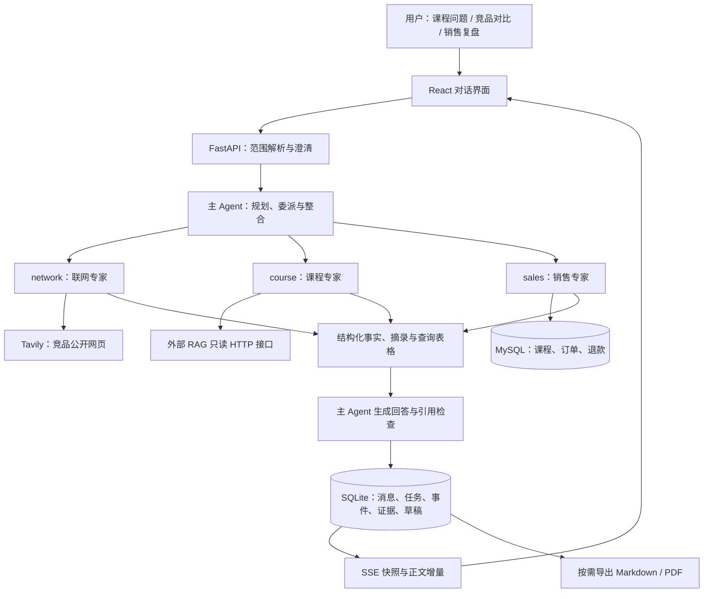

# Course Agent · 韩语课程经营调研助手

**把竞品网页、自家课程文档和销售记录放进同一次调研，用对话完成课程比较与经营复盘。**

基于 Python、FastAPI、DeepAgents / LangGraph 和 React 构建。一个主 Agent 负责规划和整合，三个专家分别处理联网搜索、课程 RAG 与销售 SQL，回答支持流式输出、来源追溯和 Markdown / PDF 导出。

[快速启动](#快速启动) · [系统架构](#系统架构) · [使用示例](#使用示例) · [验证结果](#数据与验证结果) · [详细文档](#详细文档)

> 当前为本地运行的原型应用。自家课程与销售记录为合成验证资料，在线竞品信息来自实际搜索；已有工程测试与真实模型验收，但尚有语义质量问题，具体结果见下文。

## 项目解决什么问题

单一课程知识库能回答“这门课有哪些服务”，但课程经营问题往往需要同时查三个地方：

- **外部市场**：竞品开了什么课程，公开价格、课时和授课方式是什么？
- **自家产品**：自己的课程适合谁，服务政策和竞品有什么差异？
- **内部交易**：同一时期成交、收款、退款和渠道表现发生了什么变化？

本项目将三类来源接入统一对话流程。用户可以只查一类，也可以完成综合调研；系统保留网页摘录、课程片段和实际 SQL 结果，方便回看回答依据。

销售变化只能用于描述与比较，现有数据不能证明“竞品活动导致自家销量下降”。

## 已实现能力

| 能力 | 具体行为 |
|---|---|
| 按范围调用专家 | 支持课程、竞品、销售、课程对比及综合调研，限制本次可调用的专家与工具 |
| 多轮对话与澄清 | 从消息提取课程、竞品及日期，信息不足时先追问；同会话追问可继承范围 |
| 竞品联网调研 | Tavily 搜索，区分搜索摘要与网页正文，保留 URL、采集时间和截断标记 |
| 自家课程检索 | 调用现有 RAG 的只读 HTTP 接口，保留原文、文档名及可用的章节/页码 |
| 销售分析 | MySQL 只读查询，提供月度与渠道统计工具，分别处理收款与退款时间 |
| 结构化专家交接 | 事实绑定对象、适用范围、摘录与来源；销售数字取实际工具表格 |
| 销售表直接呈现 | 程序从实际查询结果生成数字与逐行引用，主 Agent 负责解释；表格计入总篇幅，支持流式插入与按需导出 |
| 流式回答 | SSE 推送主 Agent 正文，显示检索进度，支持停止生成、断线和刷新恢复 |
| 按需导出 | 默认只回答；完成后选择 Markdown / PDF，复用已保存回答，不重跑模型 |
| 调用预算与失败处理 | 限制耗时、模型、工具及搜索次数，记录用量；失败保留已取得的证据 |
| 对话界面 | 左侧历史会话、底部输入、来源折叠查看，深浅主题自动跟随系统 |

## 系统架构



### 为什么按三个专家划分

分工依据是数据来源和工具边界。课程文档负责产品与政策，交易库负责统计，网页负责外部市场信息；三者不相互代替。

| 角色 | 可用业务工具 | 职责 |
|---|---|---|
| 主 Agent | 专家委派与任务规划 | 选择调查步骤、必要时补查、整合最终回答 |
| `network` | `internet_search` | 调查指定竞品的公开课程与服务 |
| `course` | `retrieve_course` | 检索自家课程原文，区分课程和共享政策 |
| `sales` | `sales_schema`、`sales_monthly`、`sales_channels`、`query_sales` | 先了解表结构与口径，再分析订单、金额和渠道 |

整合由主 Agent 完成，没有另设“整合子 Agent”。在线模式使用实际 Agent 调度；只查销售时不要求同时检索课程和竞品。当前尚未通过严格受控实验证明多 Agent 一定优于单 Agent。

### 一次请求如何执行

1. 用户在对话中指定课程、竞品、日期和要求；缺少必要条件时先澄清，不调用付费模型。
2. 服务创建任务，保存消息，检查同会话冲突和并发额度。
3. 主 Agent 在允许的调研范围内委派专家；工具将本次获取的资料登记为证据。
4. 专家交接事实、原文及表格，主 Agent 综合回答，正文通过 SSE 逐步展示。
5. 服务检查引用与部分回答约束，保存最终报告和任务状态；用户随后按需导出文件。

## 使用示例

以下是可直接粘贴到输入框的请求。日期采用 `YYYY-MM-DD`，竞品建议使用“竞品：机构名”的明确格式。

| 场景 | 请求示例 | 在线模式所需来源 |
|---|---|---|
| 课程答疑 | 只查课程，K03适合什么基础的学员？能否备考TOPIK II？ | 自家 RAG |
| 课程对比 | 课程对比，K01与竞品的价格、课时和服务，不查销售。<br>竞品：沪江网校 | Tavily + RAG |
| 销售复盘 | 只查销售，分析K01在2026-08-01至2026-11-01的收款、退款和渠道表现。 | MySQL |
| 综合调研 | 完整调研，对比K01与竞品的课程差异，结合2026-08-01至2026-11-01的销售记录复盘，区分事实与推测。<br>竞品：沪江网校 | Tavily + RAG + MySQL |

自家课程标识为 `K01` 零基础入门、`K02` 日常交流、`K03` TOPIK 初级备考。一次指定一门自家课程、最多三家竞品；当前范围解析采用保守规则，不能理解所有自然语言日期和机构表达。

离线演示可输入：

```text
对比K01和竞品的课程，竞品：离线示例机构
```

离线模式三路都使用固定合成资料，执行固定演示流程，不代表实时搜索或多 Agent 推理效果。

## 关键实现

### 三类证据分开管理

工具为本任务生成来源 ID：`W` 对应网页、`D` 对应课程文档、`Q` 对应 SQL 结果、`M` 对应应用定义的销售口径。统计口径不能冒充查询结果，历史任务的来源编号也不能作为本次新证据。

网络与课程专家通过结构化结果交付事实对象、适用范围、原文摘录和证据 ID。销售交接直接取工具返回的表格，减少模型重写数字造成的误差。网页内容作为资料处理，不作为可执行指令。

**来源存在、摘录存在与结论被支持是不同检查。** 当前实现了编号、摘录、对象及有限回答约束，不能将其视为完整语义事实核验。

### 销售口径与 SQL 约束

- MySQL 保存 `courses`、`orders`、`refunds`；课程正文仍由 RAG 管理。
- 使用北京时间、左闭右开区间。收款按付款时间，退款按实际退款时间。
- 区间净收款 = 区间收款 − 区间退款，不等于会计收入；退款不会从成交订单数中直接扣除。
- 月度工具使用月份骨架，保留无成交或仅有退款的月份，聚合后以 `Decimal` 计算金额差值。
- SQL 经 AST 校验，只允许限定表及函数范围内的单条只读查询；运行账号仅授予所需表的 SELECT 权限。
- 单查询最多 5 秒、500 行，超量标记截断；固定数据用独立 Python / Decimal 参考核对。

现有记录没有线索数、咨询人数和广告成本，无法据此计算咨询转化率或投放 ROI。

### 流式输出与任务恢复

正文流只展示主 Agent 的回答，专家内部结果、工具参数和模型推理字段不作为正文展示。草稿与事件先保存到 SQLite，SSE 连接先读取带游标的快照，再处理增量；刷新或重连通过快照恢复，避免重复拼接。

停止生成保留未完成草稿。进程重启后，未完成任务标记为 `INTERRUPTED`，不会自动续跑付费请求。LangGraph 检查点另行持久化。

### 执行边界

当前使用一个 Uvicorn worker，同时最多执行 2 个任务。单任务默认上限为 600 秒、60 次模型请求、40 次工具调用和 10 次搜索。网络传输、429 与 5xx 最多重试一次，各次尝试均计入预算；Token 未知时显示未知，费用仅按配置单价估算模型部分。

单路来源失败时保留其他证据并标记部分完成，无可用证据时失败。`SUCCEEDED` 表示执行和程序检查达到要求，不等于人工语义复核通过。

## 技术栈

| 层次 | 技术 |
|---|---|
| Agent 调度 | DeepAgents、LangChain、LangGraph |
| 后端与协议 | Python 3.12、FastAPI、Pydantic、HTTP / SSE |
| 检索与来源 | Tavily、外部课程 RAG HTTP 接口 |
| 数据与统计 | MySQL、SQLite、PyMySQL、SQLGlot、Decimal |
| 前端 | React、TypeScript、Vite、普通 CSS、React Markdown |
| 文件与验证 | ReportLab、pytest、独立统计参考、固定验收题集 |
| 依赖与格式 | uv / uv.lock、pnpm 锁文件、Prettier |

## 快速启动

### 1. 无密钥离线演示

以下命令面向 Windows PowerShell。需要 Python 3.12、uv、pnpm 11.25.0，以及满足 Vite 7 要求的 Node.js 20.19+ 或 22.12+。

```powershell
git clone https://github.com/leoqen/course-agent.git
cd course-agent
.\setup.ps1
.\start.ps1 -Offline
```

打开 <http://127.0.0.1:8000>。安装脚本会安装锁定依赖、构建前端、在缺失时创建 `.env`，并生成离线销售资料。离线运行不需要模型密钥、搜索密钥、MySQL 或 RAG 服务。

### 2. 接入在线服务

本地 `.env` 配置以下服务；仓库只包含无真实密钥的 `.env.example`：

| 配置 | 用途 |
|---|---|
| `RESEARCH_MODEL`、`OPENAI_BASE_URL`、`OPENAI_API_KEY` | 支持工具调用的 OpenAI 兼容模型服务 |
| `TAVILY_API_KEY` | 竞品搜索 |
| `RAG_BASE_URL`、`RAG_RESEARCH_TOKEN` | 自家课程资料只读检索接口及共享令牌 |
| `MYSQL_HOST`、`MYSQL_PORT`、`MYSQL_DATABASE`、`MYSQL_USER`、`MYSQL_PASSWORD` | 合成销售库，运行时使用只读账号 |

**课程 RAG 服务是外部依赖，本仓库不包含其完整服务。** 需提供 `POST /api/research/retrieve`，按项目约定返回课程片段；接口格式和接入步骤见 [安装与服务接入](docs/local-setup.md)。`start-rag-gateway.ps1` 用于已有相邻 `local_rag` 项目的本机集成，单独克隆此仓库后不能直接使用该脚本启动一个完整 RAG。

仓库提供独立销售演示库的 Docker Compose 配置及导入脚本。完成模型、搜索、RAG 与销售库配置后：

```powershell
.\start.ps1
```

健康接口 <http://127.0.0.1:8000/api/health> 的 `configured` 信息仅表示配置存在，不能代替真实连通性验证。在线执行会产生模型与搜索费用。

### 3. 前端开发

后端运行后，在另一个终端执行：

```powershell
cd frontend
pnpm dev
```

开发请求通过 Vite 的 `/api` 代理到本机 8000 端口；日常本机演示由后端直接托管构建后的页面。PDF 在 Windows 默认使用宋体，其他系统需配置可嵌入的中文字体路径 `RESEARCH_PDF_FONT`。

## 数据与验证结果

### 合成数据

固定种子生成 3 门课程、1800 条订单及退款记录，覆盖北京时间 **2026-05-01 至 2026-11-01（不含结束日）**。生成时保存原始记录、SHA256 清单及独立统计参考；自家课程样例也明确标注为验证资料。

这些资料用于复现统计与失败场景，不代表真实机构交易，也不能用来宣称销售提升。

### 工程测试与真实问答分开报告

| 验证 | 已记录结果 | 可以说明什么 |
|---|---|---|
| 本地工程测试 | 101 项通过，1 条既有依赖弃用警告 | 覆盖查询约束、统计、任务状态、交接、SSE 等工程行为；包含脚本模型测试 |
| 前端检查 | 格式检查、TypeScript 与生产构建通过 | 代码格式与构建链路可用 |
| r13 一轮 6 道冻结新题 | 执行：3 SUCCEEDED、3 PARTIAL；开发人工复核：3 pass、3 needs_fix | 开放问答仍有篇幅、未知范围和字面误报等问题 |
| r22 一轮 5 道冻结新题 | 执行：4 SUCCEEDED、1 PARTIAL；开发复核：4 pass、1 needs_fix；42 项销售值逐字段匹配独立参考 | 五题均在篇幅内，综合题仍可能因竞品证据不足为 PARTIAL；不是大样本准确率 |
| 固定评测目录 | 50 条任务，30 开发 / 20 留出 | 提供评测题集；SQL 脚本只核对其中统计组件，不能视为 50 题语义准确率 |

最新自主优化增加明确字段筛选、实际搜索次数上限、缺引用回答的 PARTIAL 保存及销售表行引用检查。3 道冻结新题首次执行为 1 SUCCEEDED、2 PARTIAL，开发复核为 1 pass、2 needs_fix；修复后两道失败题在线回归均成功，不计作新的留出成绩。2026-11-20 清理虚拟机容器日志并重启后，Milvus 集合已 Loaded，真实 RAG 检索恢复；课程适配与修复后的排课回归成功，综合题三类来源及 12 项销售值正确，但仍因篇幅超限与摘录拒收为 PARTIAL，详见 [自主优化记录](docs/autonomous-optimization.md)。较早 r14 修复与失败历史保留在 [可靠性定向回归](docs/reliability-regression.md)。

真实问答结论对应各自冻结版本；代码整理不构成新的真实模型验收。r13 详情见 [回答约束验收](docs/answer-contract-acceptance.md)，较早完整 15 题记录见 [固定版本验收](docs/final-acceptance.md)。

最新销售表直接呈现、流式与导出一致性、冻结新题及剩余失败见 [报告稳定性验收](docs/report-stability.md)。可直接阅读 [综合成功样例](examples/reports/release-combined.md) 与 [部分完成样例](examples/reports/release-partial.md)。

无需付费模型的本地检查：

```powershell
.\.venv\Scripts\python.exe -m pytest tests -q
.\.venv\Scripts\python.exe scripts/evaluate.py --split dev
```

前端检查：

```powershell
cd frontend
pnpm format:check
pnpm build
```

带 `--live` 的评测会调用真实服务并产生费用，使用前请阅读 [评测说明](docs/local-setup.md)。

## API 入口

| 接口 | 用途 |
|---|---|
| `POST /api/chat` | 提交消息，返回澄清或创建任务 |
| `GET /api/conversations` | 列出会话 |
| `GET /api/conversations/{thread_id}` | 恢复消息与关联任务 |
| `POST /api/task` | 直接提交结构化调研请求 |
| `GET /api/tasks/{id}` | 查询任务状态、回答、用量及文件 |
| `GET /api/tasks/{id}/stream` | SSE 快照、正文增量及执行进度 |
| `GET /api/tasks/{id}/evidence` | 查看本次证据 |
| `GET /api/tasks/{id}/events` | 查看执行事件 |
| `POST /api/task/{id}/cancel` | 停止任务 |
| `POST /api/tasks/{id}/export` | 按需导出 Markdown / PDF |

结构化请求示例（在线模式只调销售专家；先配置销售库与模型）：

```http
POST /api/task
Content-Type: application/json

{
  "query": "按月复盘收款、退款和净收款，保留空月份。",
  "course_id": "K01",
  "research_scope": "sales",
  "start_date": "2026-08-01",
  "end_date": "2026-11-01",
  "output_format": "none"
}
```

接口交互文档：服务启动后访问 <http://127.0.0.1:8000/docs>。

## 代码导航

```text
korean/
  server.py         HTTP、任务生命周期、SSE 与文件接口
  runtime.py        主 Agent / 三个专家组装、整合与引用检查
  prompts.py        主 Agent 与专家提示词
  tools.py          搜索、课程检索、销售工具与证据登记
  budget.py         调用次数、耗时与 Token 预算
  streaming.py      主 Agent 正文流与草稿保存
  handoff.py        专家结构化交接与有限回答约束
  web_context.py    网页分段、对象与上下文处理
  sales.py          只读 SQL 校验、合成数据与销售统计
  conversation.py   对话范围解析与澄清
  store.py          SQLite 消息、任务、事件及证据
  models.py         请求和范围约束
  config.py         配置与课程标识
  pdf.py            PDF 导出
frontend/src/
  ResearchApp.tsx   会话切换、发送与 SSE 订阅
  api.ts            HTTP 客户端
  types.ts          页面数据类型
  status.ts         任务状态展示
  components/       回答、Markdown 与图标组件
scripts/            合成数据、服务接入、统计参考与验收
tests/             本地工程测试
examples/           课程样例与固定题集
docs/               架构、运行、验收与讲解材料
```


## 详细文档

| 文档 | 内容 |
|---|---|
| [安装与服务接入](docs/local-setup.md) | 离线启动、RAG 协议、销售库导入与评测命令 |
| [架构与统计口径](docs/architecture-korean.md) | 数据边界、任务状态、预算与指标定义 |
| [代码讲解](docs/code-guide.md) | 沿一次请求阅读源码与常见技术追问 |
| [结构化专家交接](docs/structured-handoff.md) | 原子事实、表格交接与已知限制 |
| [引用边界](docs/evidence-boundaries.md) | 来源编号、摘录与有限约束 |
| [本轮可靠性回归](docs/reliability-regression.md) | 有限规则修复、环境阻断与整合回放 |
| [自主优化与验收](docs/autonomous-optimization.md) | 搜索硬限制、销售行引用、冻结新题及失败题回归 |
| [报告稳定性与新题](docs/report-stability.md) | 查询表直接呈现、流式/导出一致性与五道新题逐项复核 |
| [r13 新题验收](docs/answer-contract-acceptance.md) | 最新冻结问答结果与未通过项 |

## 来源与致谢

项目参考 [DeepSearch Agents](https://github.com/didilili/deepsearch-agents) 的多专家调度思路，并沿用部分前端渲染代码；Agent 框架使用 DeepAgents / LangGraph。固定提交、沿用范围、本项目实现与授权信息见 [UPSTREAM.md](UPSTREAM.md)。
