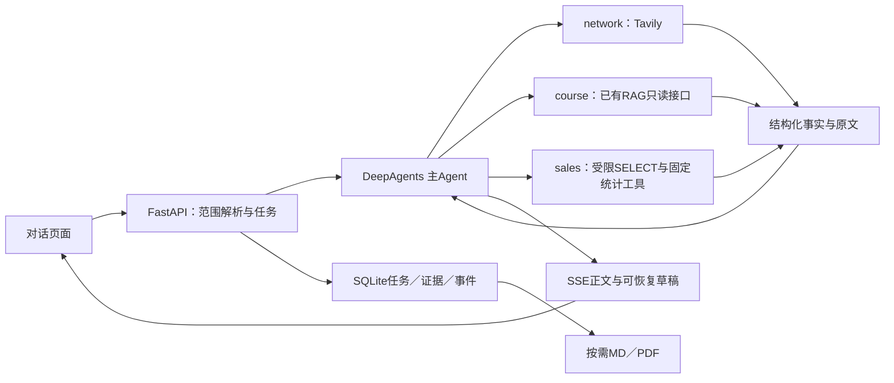

# 求职演示与讲解

定位：基于DeepAgents的韩语课程经营调研助手，已有销售RAG的扩展项目。公开竞品网页、自家课程政策、订单退款分别由三个专家处理，主Agent按问题选择来源并整合。自家资料和销售为合成验证数据，展示工程能力，不宣称真实业务收益。

## 演示前准备

本机依赖：销售MySQL、课程资料的MySQL与Milvus、模型和Tavily服务；主项目与原RAG使用不同Python环境。本机已配置，迁移电脑时按README重新准备，不能只复制.env或默认账号密码。

在项目目录分别启动课程只读网关和主服务；服务已运行时直接使用，不重复占用端口。

```powershell
.\start-rag-gateway.ps1
```

```powershell
.\start.ps1
```

打开 <http://127.0.0.1:8000>。健康接口的configured只是配置存在；真实连通以已保存验收和实际查询为准。网络、模型或课程服务不可用时展示明确失败/部分结果，不用离线样例冒充在线成功。离线演示可另起端口：`.\start.ps1 -Offline -Port 8001`，它不调用模型，不代表Agent推理。

## 三分钟主线

最新可复核版本与5道新题见 [销售表与新题验收](report-stability.md)。主线建议优先使用下面的“本轮已验证演示”，较早示例仍保留作练习；不要把旧示例数字与新题区间混用。

**0:00—0:30，问题与架构。** 销售人员想知道自家课程和竞品的差异，以及销售同期发生了什么。课程政策适合文档检索，订单退款适合SQL聚合，公开竞品需联网；不让数据库复制课程文档。



**0:30—1:15，先展示容易核对的回答。** 新对话输入：

> 只查销售，K03在2026-08-01至2026-11-01按渠道的成交订单数、收款是多少？能否计算咨询转化率和广告ROI？简短回答并引用。

预期统计：内容平台123单/366540元，广告投放89单/265220元，自然咨询129单/384420元。数字来自固定合成源文件与MySQL；缺咨询量、广告费，不能算转化率或ROI。展开一条Q查询与一条M口径：Q是SQL及实际结果，M是应用定义的数据能力说明。

**1:15—2:15，展示三路协作。** 新对话输入：

> 完整调研，自家K03，竞品：沪江网校。销售区间2026-09-01至2026-11-01。区分TOPIK I与II及适合基础，比较方式和价格；按月列订单、收款、退款、净收款。最多2次搜索，课程服务没有本次证据就写未知，不推断销售因果。简洁回答并引用。

运行中讲解主Agent只向需要的专家委派，检索阶段显示进度，正文生成时SSE更新。一次请求可能需要几十秒，不承诺固定完成时间。网络现行售价可能没有取得；历史班期和平台说明不能强当现行课程承诺。遇到PARTIAL就展示原因和证据，不把“运行结束”说成“答案全对”。

K03月度参考：9月140单、收款417200、退款32780、净384420元；10月142单、收款423160、退款32780、净390380元。付款与退款分别按发生时间聚合，结束日期不计入。两个月变化不能证明竞品影响。

**2:15—3:00，展示工程与限制。** 展开调研过程和来源，指向网页URL、课程页码、SQL结果；回答后按需导出MD/PDF，刷新可恢复会话。展示验收文档，说明自动测试覆盖工程约束，语义结论需逐项核对。最终完整15题以[固定版本验收](final-acceptance.md)为准。

演示问题通过/api/chat创建，出现在页面会话中；批量验收通过/api/task提交，只在任务API中保存，不会自动进入侧栏。每次live演示会产生模型、检索和搜索费用，优先用已有任务API记录讲解，不反复提交同题。

## 面试必须讲清楚的设计

| 追问 | 回答重点 |
|---|---|
| 为什么用三个专家？ | 三类来源有不同工具、权限和失败方式，便于隔离及追踪；单纯两步查询不必强上多Agent。当前未做受控单/多Agent对照，不能说多Agent更准确或更省钱。 |
| 主Agent做什么？ | 规划、按范围委派和整合。没有另设整合子Agent；文件由服务生成，不让模型操作文件路径。 |
| RAG与MySQL是否重复？ | RAG检索政策原文；MySQL聚合交易。原RAG销售回复链不直接复用，新增只读检索接口，避免混入客户对话和画像。 |
| 如何防止SQL改数据？ | 应用校验单条受限SELECT，拒绝跨库/写入/文件函数；MySQL运行账号另有限定表SELECT权限。单次查询时限与行数限制。只读不保证统计语义正确。 |
| 跨月退款怎么处理？ | 收款按paid_at、退款按refunded_at，退款不限定原订单同期付款，分别聚合；月份骨架保留空月/仅退款月，Decimal算净收款。 |
| 引用ID存在就真实吗？ | 不能。还有当前调用证据范围、可见摘录、角色对象与有限词边界检查；否定和同义词会误报/漏报，开发复核仍必需。 |
| 流式如何恢复？ | 主模型正文落草稿和事件，SSE快照加游标；重连以快照为准，重写时reset，完成后用最终回答替换草稿。专家文本和推理不流给用户。 |
| 多轮追问如何避免旧证据？ | 历史仅作上下文，新任务用独立检查点、重新检索，本次回答只接受本次证据ID。输入范围采用保守规则，非通用意图识别。 |
| 成本怎么控制？ | 模型/工具/搜索/时间预算，模型不自动重试；必要的传输重试计数；最多一次回答修订。token与次数可测，费用单价未知不填金额。 |
| 为什么不用模型直接画销售表？ | SQL算对不代表模型能抄对；直接从工具结果呈现原值及Q引用，主模型解释。缺标记、重复表格会修订，仍失败则PARTIAL，表格也计入总字数。 |
| 怎么证明这次更好？ | 五道冻结新题有四道通过、一题部分完成；42项销售值逐字段核对。没有随机受控对照，不能宣称总体准确率提升或多Agent优于单Agent。 |

## 本轮已验证演示（约四分钟）

1. **30秒定位**：文档政策、公开网页、交易记录各有来源边界。说明合成数据及使用 Codex 辅助，不声称真实销售增长。
2. **一分钟销售表**：输入 `只查销售K02，用sales_monthly列2026-05-18至2026-07-03每月订单、收款、按发生时间退款和净收款，结束日不含。只要表和一句统计口径，不算环比，350字内。` 已验证三行：32/79360/2480/76880；96/238080/32240/205840；8/19840/0/19840。展示每行双Q及口径M；指出表格由程序直接呈现。
3. **一分钟综合调研**：输入 `完整调研自家K03，竞品：沪江网校。只比较适用基础和现行完整售价，最多2次搜索，TOPIK I与II不能混淆；sales_monthly列2026-05-26至2026-07-11每月订单、收款、退款、净收款，结束日不含。550字内，三类证据引用，不推断销售因果。` 已验证自家2980元、基础及水平评估；沪江列表免费不能当完整售价。三行销售：15/44700/0/44700；61/181780/5960/175820；14/41720/2980/38740。
4. **一分钟失败与交付**：展示 [成功报告样例](../examples/reports/release-combined.md) 和 [部分完成样例](../examples/reports/release-partial.md)。后者网络摘录不足，仍保留正确销售表而不是伪造竞品现价。导出MD/PDF、刷新恢复；展开一次原文与SQL。现场网络变化可能产生不同结果，已保存案例更适合解释边界。
5. **30秒收尾**：101项工程测试与5道新题分开报告；剩余重点是竞品对象定位和专家提取稳定性。无公网多用户、高并发或真实业务提升承诺。

完整样例是对应冻结题的保存结果，含合成数据声明与公开来源；不是每次运行必得相同网页。题库API任务不会自动出现在左侧对话历史，现场需要通过聊天输入新请求，或直接打开样例讲解，不假装历史任务是刚生成的。

## 学习与讲解顺序

1. 跑通并能解释 `korean/models.py → conversation.py → server.py` 的请求、范围与状态。
2. 阅读 `runtime.py` 的工具包装、三个专家、预算与流式消息筛选；能画出一次请求路径。
3. 阅读 `sales.py` 的月度统计，自己在小数据上算一次跨月退款，理解为什么不能直接JOIN后SUM。
4. 阅读 `handoff.py`，解释为什么quote存在仍不保证value正确；用失败记录说明字面检查局限。
5. 对照 `tests/test_live_graph.py` 与 `tests/test_evidence_boundaries.py` 区分脚本模型的工程测试与真实模型验收。

代码大量由Codex辅助完成时，简历不要把“运行过项目”写成“独立设计并手写所有模块”。先掌握上述链路、亲自修改并验证一个边界问题，再将理解和承担范围写入简历。
